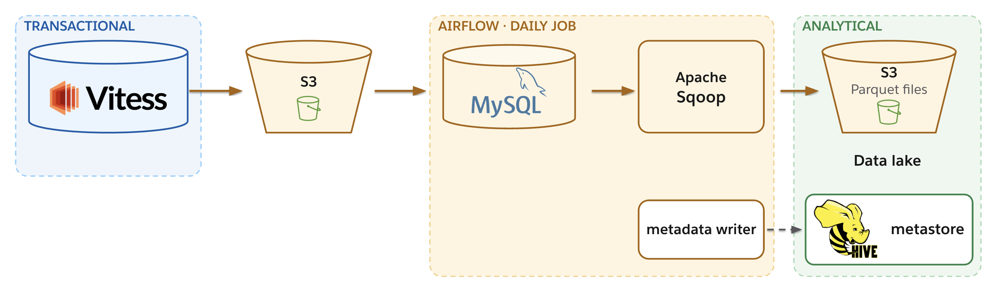
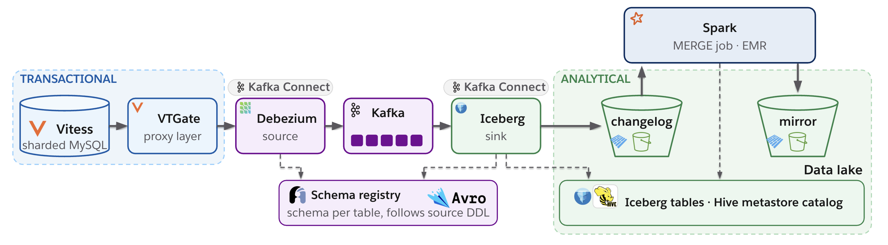

# The Taming of Change Data Capture

Notes and links for **"The Taming of Change Data Capture: Lessons from Slack's Streaming Pipelines"**, Current 2026, San Francisco, November 4 ([sessions](https://current.confluent.io/san-francisco/sessions)). Every issue and pull request shown in the slide footers is linked here.

> A batch copy is stateless: every run starts fresh. A change stream accumulates state: an error stays unless you find it.

⭐ **Star this repo** to find these notes again later, and to help others find them too.

## Contents

1. [The problem](#1-the-problem): five criteria, batch vs CDC
2. [The architecture](#2-the-architecture): batch, goals, source, sink, the pipeline today
3. [Operational challenges](#3-operational-challenges)
   - [Data loss](#data-loss): Kafka Connect, Debezium, Iceberg, and how they were detected
   - [Consistency](#consistency): ordering through scaling, closing time windows
   - [Load balancing](#load-balancing): long-lived streams
   - [Performance](#performance): throughput, source to producer
   - [Resource limits](#resource-limits): chunking large transactions
4. [Takeaways](#4-takeaways)
5. [Upgrade checklist](#5-upgrade-checklist)

## 1. The problem

Every change in the transactional database, replicated to an analytical store for business metrics, experiments and ML, without running those workloads on the app's database.

**How to grade a pipeline**

| Criterion | Question it answers |
|---|---|
| Latency | How old is the data when it lands? |
| Isolation | Does analytics stay off the app's database? |
| Correctness | Did every row, every column and every change arrive? |
| Maintenance | Who maintains it, and who fixes it? |
| Cost | What does it cost, and what does the cost grow with? |

**Two ways to replicate:** copy the table, or read its change log.

| | Batch snapshot (each run copies every row) | Change data capture (every change, as it commits) |
|---|---|---|
| Latency | ✗ once per run | ✓ streaming |
| Isolation | ~ depends | ~ depends |
| Correctness | ✓ rebuilt: every run starts fresh, so a bad run is one run | ~ cumulative: an error stays unless you find it, so verify continuously |
| Maintenance | ~ depends | ~ depends |
| Cost | ✗ grows with table size | ✓ grows per change |

## 2. The architecture

### The first system: batch (Apache Sqoop)

Restore a backup, dump every table, every day, to Parquet files in a data lake on S3. A daily Airflow job restores the nightly backup into MySQL, runs Apache Sqoop to write Parquet to S3, then a separate metadata step registers the table in the Hive metastore. Sqoop itself only writes files.

| Criterion | Batch | |
|---|---|---|
| Latency | ✗ | daily, per-table jobs; largest 21–40+ h (built into batch) |
| Isolation | ✓ | restores a backup, never touches prod |
| Correctness | ✓ | every row, every column: a full copy each run. Never reconciled row for row; a failed run was visible, a missing output was redone automatically, and every run started from scratch |
| Maintenance | ✗ | Sqoop retired in 2021, so every fix is in-house (fixable in batch) |
| Cost | ✗ | grows with table size: millions a year (built into batch) |

**Decision:** pay for changes, not table size: change data capture.

### Goals for CDC

Get changes out of the database and into the data lake. Keep isolation and correctness; improve latency, maintenance and cost.

| Design | Isolation | Latency | Cost |
|---|---|---|---|
| One system that reads the log and writes tables | ✗ one failure stalls both | ✗ the lake is the only consumer | ✗ scales as one unit |
| **Source → Kafka → sink** (chosen) | ✓ failures stay apart | ✓ real-time apps read the log too | ✓ scale each side |

### Choosing a source

| Option | Vitess | Low custom code | Verdict |
|---|---|---|---|
| Managed CDC vendor | ✗ | | No Vitess support |
| Build on VStream | ✓ | ✗ | Own deserialization, offsets, scaling, work distribution |
| **Debezium + Kafka Connect** (chosen) | ✓ | ✓ | Vitess support, maintained stack |

### Choosing a sink

The option passed on at first was revisited.

| Option | Low custom code | Reliable | Setup time | Verdict |
|---|---|---|---|---|
| Iceberg + Spark Streaming | ✗ | | | Custom writer and merge job |
| **Iceberg + Kafka Connect** (chosen) | ~ | ✓ | ~1 week | Custom merge job |
| Hudi + Flink (tried first) | ✓ | ~ | months | Fully open source |

References: [apache/hudi#7973](https://github.com/apache/hudi/issues/7973) · [#9971](https://github.com/apache/hudi/issues/9971) · [#9808](https://github.com/apache/hudi/issues/9808) · [#9915](https://github.com/apache/hudi/issues/9915) · [#9186](https://github.com/apache/hudi/issues/9186)

### The architecture today

Capture, transport, store.

- **Capture:** Vitess (sharded MySQL) → VTGate (proxy layer) → Debezium source on Kafka Connect.
- **Transport:** Kafka, with a schema registry holding an Avro schema per table that follows the source DDL.
- **Store:** Iceberg sink on Kafka Connect → changelog tables → Spark `MERGE` job on EMR → mirror tables. Both are Iceberg tables in a Hive metastore catalog.

**Scale:** 750k+ writes per second · 1 PB+ of data · 3,000+ shards.

### How it measures up

| Criterion | Batch before | CDC after |
|---|---|---|
| Latency | ✗ 21–40+ h | ✓ 0.5 s to Kafka, 5–10 min to the changelog table |
| Isolation | ✓ restores a backup | ✓ replica tablets, own CDC VTGates |
| Correctness | ✓ a full copy each run | ✓ rows and schema checked continuously |
| Maintenance | ✗ every fix in-house | ✓ community projects, fixes go upstream |
| Cost | ✗ grows with table size | ✓ ~90% lower |

**Result:** latency, maintenance and cost solved; isolation and correctness kept.

## 3. Operational challenges

Five areas: data loss, consistency, load balancing, performance and resource limits. Each case has the same four parts: **why it matters** (who it affects, since when), the **fix** (what changed, for this stack), the **result** (the after, measured), and the **principle** (what to do in any pipeline). All are fixed upstream.

Bracketed figures are the volume and period observed, e.g. [~4T records, 1.8 years].

### Data loss

Data-loss bugs in three open-source projects.

#### Kafka Connect: a retry that dropped records

- **Why it matters:** Kafka Connect 3.0 to 3.9 (Sep 2021 to Mar 2025), with the default `errors.tolerance=none`, in sources and sinks. Records 1 and 3 were written, record 2 failed (here, on its schema registry call), and the offset was committed at 3, so record 2 was never retried. ~20 rows lost [~500B, 3 months].
- **Fix:** upgrade to Kafka ≥ 4.0. On 3.x, set `errors.retry.timeout=-1`. Alert on skipped records.
- **Result:** 0 rows lost, 0 alerts [~4T, 1.8 years].
- **Principles:** an invariant per metric · configs must match behaviour.
- [KAFKA-18073](https://issues.apache.org/jira/browse/KAFKA-18073) · [apache/kafka#18146](https://github.com/apache/kafka/pull/18146)

#### Debezium: a crash between two records

- **Why it matters:** Debezium Vitess connector, Oct 2020 to Jan 2025. In transaction n, `UPDATE id 1 → 2` changes the primary key, so it is emitted as two records: DELETE id 1 and CREATE id 2. The offset recorded "transaction n done" after the DELETE; a crash before the CREATE resumed at transaction n + 1, and CREATE id 2 was lost. 1 row lost [~2T, 3 years].
- **Fix:** there is no config workaround; upgrade the Vitess connector to ≥ 3.0.8.
- **Result:** 0 rows lost [~4T, 1.7 years].
- **Principles:** a write can fan out to many records · commit the offset after the last one.
- [DBZ-8594](https://issues.redhat.com/browse/DBZ-8594) · [debezium-connector-vitess#224](https://github.com/debezium/debezium-connector-vitess/pull/224)

#### Iceberg: the zombie coordinator

- **Why it matters:** Iceberg Kafka Connect sink, Jul 2024 to Sep 2026; a race between two coordinators. A zombie coordinator kept running alongside the current one and moved the control topic's consumer-group offset back to an offset that retention had already deleted (6 in the slide's illustrative numbering, after the current coordinator had committed 8). When the current coordinator restarted and read it, it was out of range; the default reset to latest jumped to the end (10), and the records in between (9) were skipped. 2.2M rows skipped [~4T, 2 years].
- **Fix:** upgrade to Iceberg sink ≥ 1.12 (guard); fencing is coming in 1.13. Alert when more than one coordinator is active, and set the offset reset to earliest.
- **Result:** 0 rows lost, 0 alerts [~800B, 4 months].
- **Principles:** fence old writers · offsets only move forward.
- [apache/iceberg#17551](https://github.com/apache/iceberg/issues/17551) · [#17552](https://github.com/apache/iceberg/pull/17552) · [#18039](https://github.com/apache/iceberg/pull/18039)

#### How they were detected

Each check compares two points; it only sees what happens between them.

| Check | What it verifies | How to set it up | Example | How often | Caught |
|---|---|---|---|---|---|
| 1. Component metrics | One component works | Alert on its metrics (existing or contributed) | skipped records = 0 | Real time | Kafka Connect bug |
| 2. Point to point | Two components agree | Check an invariant between them | offset gaps | Hourly | zombie coordinator |
| 3. End to end | Source matches destination | Align on a transaction or time boundary | row counts, primary-key diff | Daily to weekly | Debezium and Kafka Connect bugs |

### Consistency

#### Ordering that survives scaling

Carry order in the event, not in the Kafka partition.

- **Why it matters:** two changes to the same row (id 47): which came first? Every CDC system must answer this.
  - Source timestamp: limited granularity, and clock drift.
  - Kafka partition and offset: needs key = primary key, and changes when partitions change.
  - Transaction ID: in every record, but a set, not a number.
- **Fix:** ordering fields in every record, derived from the transaction ID: **epoch** (shard generation), **rank** (transaction ID sum), **order** (position in the transaction).
- **Result:** parallelism changed at every stage (reshard the source, change connector tasks, add Kafka partitions) with no re-bootstrap and no reorder.
- **Principles:** order by source position · nothing from record metadata.
- [debezium-connector-vitess#188](https://github.com/debezium/debezium-connector-vitess/pull/188) · [#207](https://github.com/debezium/debezium-connector-vitess/pull/207) · [#208](https://github.com/debezium/debezium-connector-vitess/pull/208) · [#269](https://github.com/debezium/debezium-connector-vitess/pull/269)

#### Closing a time window with heartbeats

Daily jobs need a complete day; a quiet shard can't say it's past midnight.

- **Why it matters:** daily jobs (e.g. daily users, billing data) need the whole window from every shard.
- **Fix:** a heartbeat row every second, in every shard. Slack proposed keyspace heartbeats in Vitess ([vitessio/vitess#16477](https://github.com/vitessio/vitess/issues/16477)), Vitess implemented them in v21 ([#16593](https://github.com/vitessio/vitess/pull/16593)), and Slack wrote the Debezium side that streams them ([DBZ-8775](https://issues.redhat.com/browse/DBZ-8775), [debezium-connector-vitess#232](https://github.com/debezium/debezium-connector-vitess/pull/232)).
- **Result:** time to close a day went from more than 6 h (row changes only) to under 3 s. Time-window incidents: 3 in 3 months with lag metrics; 0 in 1.5+ years with heartbeats.
- **Principles:** heartbeat every source · define idle alerts.
- [vitessio/vitess#16477](https://github.com/vitessio/vitess/issues/16477) · [DBZ-8775](https://issues.redhat.com/browse/DBZ-8775) · [debezium-connector-vitess#232](https://github.com/debezium/debezium-connector-vitess/pull/232)

### Load balancing

#### Load balancing long-lived streams

A hot VTGate lags every stream on it, and headroom costs money.

- **Why it matters:** hot hosts cause lag; idle hosts are paid headroom. 11 lag alerts [~1T, 6 months].
- **Measure:** spread σ/μ (coefficient of variation), hot spot max/μ, and a heat map of streams per host over time, which is what showed where streams were piling up.
- **Fix:** replace pick first (the default) with weighted round robin rather than plain round robin, and add a max stream age with jitter so long-lived streams rebalance gradually instead of all at once.
- **Result:** balanced, with a 50% smaller pool and lower cost; 0 hot-VTGate lag alerts [~600B, 3 months].
- **Principles:** pick the balancing policy deliberately · rebalance long-lived connections.
- [vitessio/vitess#18282](https://github.com/vitessio/vitess/pull/18282) · [#19800](https://github.com/vitessio/vitess/pull/19800) · [#21233](https://github.com/vitessio/vitess/pull/21233)

### Performance

#### Throughput: profile every stage, source to sink

The slowest stage sets the throughput. Throughput matters twice: how long a snapshot or a catch-up takes, and whether the pipeline keeps pace with the source at all.

| Step | Before | Fix |
|---|---|---|
| Profile the source (VTGate CPU per event) | cloning: 80% CPU | flag to skip the clone: read it, don't copy it |
| Parallelize connector tasks | 1 task in total | tasks = shards (1,000+ on the largest keyspace) |
| Cut per-event work (connector queue) | idle producer | less string serialization, less work per event |
| Tune the producer (throughput) | low MB/s | `linger.ms` 100 ms, `batch.size` 512 KB: higher throughput |

- **Result:** time to snapshot the largest table went from 18 days to 6 h, 72× faster.
- **Principles:** profile every stage · the bottleneck moves after each fix.
- [vitessio/vitess#18274](https://github.com/vitessio/vitess/pull/18274) · [debezium-connector-vitess#91](https://github.com/debezium/debezium-connector-vitess/pull/91) · [#257](https://github.com/debezium/debezium-connector-vitess/pull/257) · [#231](https://github.com/debezium/debezium-connector-vitess/pull/231) · [DBZ-8757](https://issues.redhat.com/browse/DBZ-8757) · [DBZ-8879](https://issues.redhat.com/browse/DBZ-8879)

### Resource limits

#### Bounding memory: chunking transactions

One transaction larger than the VTGate's memory.

- **Why it matters:** one transaction of 1,000 rows × 10 MB row images. VTGate buffered the whole transaction (~10 GB total) until it ran out of memory and crash-looped; Debezium never received it and kept retrying. The shard stalled and the latency SLA was breached. 1 transaction [~5T, 3 years].
- **Fix:** short term, scale up memory in VTGate and the Debezium Java heap (still no upper bound). Long term, stream the transaction in chunks, one chunk in memory at a time.
- **Result:** 0 crashes [~2T, 10 months], with half the memory and CPU per pod and ~50% lower compute cost.
- **Principles:** bound every buffer · when stalled, size the binlog transaction.
- [vitessio/vitess#18850](https://github.com/vitessio/vitess/pull/18850) · [#18849](https://github.com/vitessio/vitess/pull/18849) · [debezium-connector-vitess#268](https://github.com/debezium/debezium-connector-vitess/pull/268) · [#269](https://github.com/debezium/debezium-connector-vitess/pull/269)

## 4. Takeaways

| Area | Takeaway | Where |
|---|---|---|
| Architecture | Isolate from the app | [Goals](#goals-for-cdc) |
| | Race the alternatives | [Choosing a sink](#choosing-a-sink) |
| | CDC scales with change | [The problem](#1-the-problem) |
| Operations | Check correctness continuously | [Detection](#how-they-were-detected) |
| | Fence old writers | [Zombie coordinator](#iceberg-the-zombie-coordinator) |
| | Bound every buffer | [Chunking](#bounding-memory-chunking-transactions) |
| | Rebalance long streams | [Load balancing](#load-balancing-long-lived-streams) |
| | Profile every stage | [Throughput](#throughput-profile-every-stage-source-to-sink) |
| | Heartbeat every source | [Heartbeats](#closing-a-time-window-with-heartbeats) |
| | An invariant per metric | [Kafka Connect](#kafka-connect-a-retry-that-dropped-records) |
| | Verify configs match behaviour | [Kafka Connect](#kafka-connect-a-retry-that-dropped-records), [Zombie coordinator](#iceberg-the-zombie-coordinator), [Load balancing](#load-balancing-long-lived-streams) |
| | Order by source position | [Ordering](#ordering-that-survives-scaling) |

## 5. Upgrade checklist

| If you run | Do this |
|---|---|
| Kafka Connect 3.0 to 3.9 | Upgrade to Kafka ≥ 4.0, or set `errors.retry.timeout=-1`. Alert on skipped records. |
| Debezium Vitess connector < 3.0.8 | Upgrade to ≥ 3.0.8. There is no config workaround. |
| Iceberg Kafka Connect sink < 1.12 | Upgrade to ≥ 1.12 (guard); fencing is coming in 1.13. Alert when more than one coordinator is active, and set the offset reset to earliest. |
| Vitess, with very large transactions | Vitess ≥ 24 streams transactions in chunks; set a chunk size. |

## Earlier talks

- "Change Data Capture & Kafka: How Slack Transitioned to CDC with Debezium & Kafka Connect," Current 2024. [Video](https://www.youtube.com/watch?v=ZCkJhOEhslw)
- "Change Data Capture at Scale: Insights from Slack's Streaming Pipeline," Current New Orleans 2025. [Video](https://current.confluent.io/post-conference-videos-25/change-data-capture-at-scale-insights-from-slacks-streaming-pipeline-e-nola25)

Thomas Thornton · [@tomthornton](https://x.com/tomthornton)
